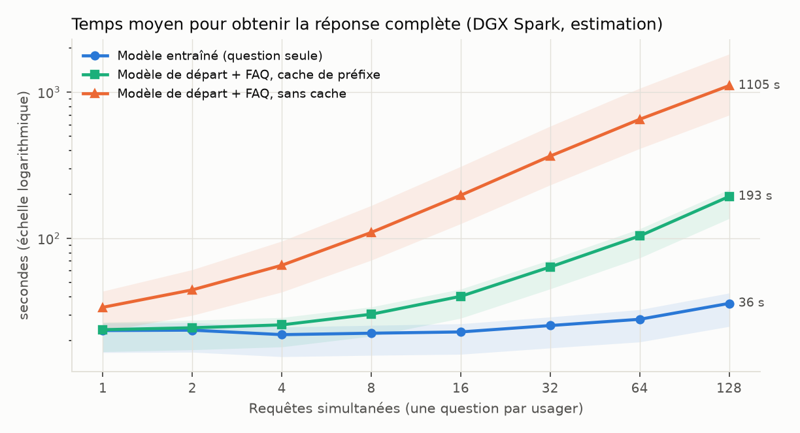
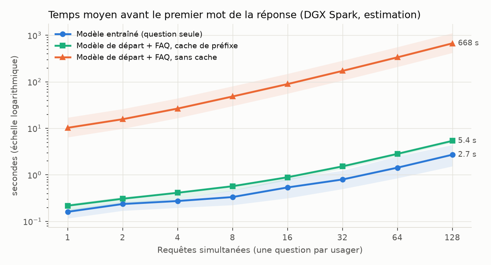
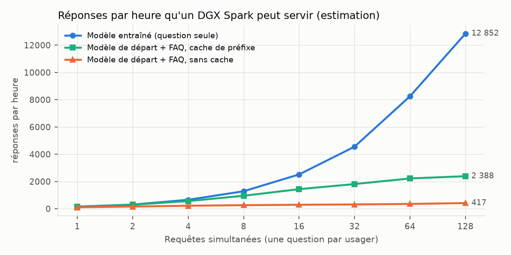
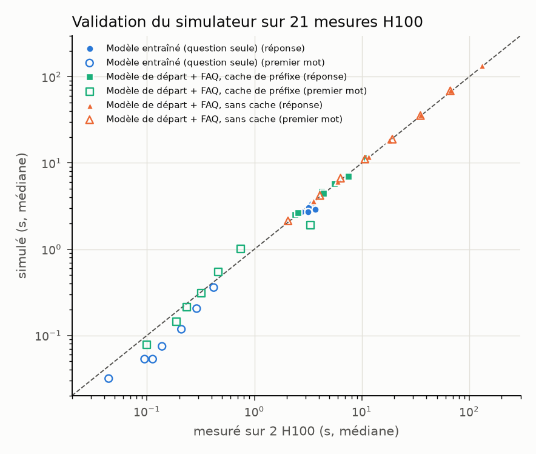

# La FAQ dans les poids ou dans le contexte : ce que l'on gagne à l'usage

**Expérience 01 (FAQ « Mon espace santé ») : temps de réponse et tokens sur un DGX Spark, 13 novembre 2026**

## 1. La question

Le modèle entraîné de l'expérience 01 (Gemma 4 31B, version 5 bits pour RTX 5090) connaît la FAQ « Mon espace
santé » sans l'avoir sous les yeux. La solution sans entraînement consiste à donner au même modèle, avant entraînement,
la FAQ entière dans son contexte à chaque question. Les deux répondent presque aussi bien (expérience 01, 704 questions
de test jamais vues) :

| Modèle | Strict | Complétude | Fidélité |
|---|---|---|---|
| Gemma 4 31B entraîné, 5 bits (modèle RTX 5090) | 81,1 % | 75,7 % | 97,4 % |
| Gemma 4 31B de départ, FAQ entière dans le contexte | 79,8 % | 79,0 % | 99,6 % |

Ce document chiffre ce que coûte chacune des deux solutions à l'usage, sur un DGX Spark (puce GB10, 128 Go de mémoire
unifiée à 273 Go/s) servant les usagers avec vLLM. Chaque usager pose **une seule question** (pas de conversation).
On fait varier le nombre de questions qui arrivent en même temps, de 1 à 128.

Trois façons de servir sont comparées :

- **Modèle entraîné** : il reçoit une consigne courte (« Tu es l'assistant de Mon espace santé. ») et la question.
- **Modèle de départ + FAQ, sans cache** : chaque requête contient la FAQ entière, recalculée à chaque fois.
- **Modèle de départ + FAQ, cache de préfixe** : la FAQ, identique pour tous, est calculée une fois et gardée en
  mémoire par vLLM (option activée par défaut). C'est la meilleure configuration possible sans entraînement.

## 2. Résumé

| Requêtes simultanées | 1 | 16 | 64 |
|---|---|---|---|
| Tokens à lire par requête, entraîné / FAQ | 46 / 15 341 | idem | idem |
| Réponse complète, modèle entraîné | 23 s | 23 s | 28 s |
| Réponse complète, FAQ avec cache de préfixe | 24 s | 40 s | 104 s |
| Réponse complète, FAQ sans cache | 34 s | 197 s | 650 s |
| Réponses par heure, entraîné / FAQ avec cache / FAQ sans cache | 154 / 152 / 107 | 2 517 / 1 437 / 293 | 8 252 / 2 222 / 354 |

- **Tokens** : le modèle entraîné lit 333 fois moins de tokens par question (46 contre 15 341) et traite au total
  81 fois moins de tokens par échange, réponse comprise (192 contre 15 474).
- **Un usager seul** : avec le cache de préfixe, la différence de temps est faible (23 s contre 24 s). Sans cache, la
  lecture de la FAQ ajoute 10 secondes avant le premier mot.
- **Plusieurs usagers** : l'écart se creuse vite, parce que chaque mot généré pour chaque usager oblige à relire en
  mémoire le cache de la FAQ (environ 1,5 Go par usager). À 16 usagers simultanés, la réponse arrive 1,8 fois plus vite
  avec le modèle entraîné qu'avec la meilleure solution sans entraînement ; à 64, 3,7 fois plus vite ; à 128, 5,4 fois.
- **Capacité** : un DGX Spark sert environ 12 900 réponses par heure avec le modèle entraîné, contre environ 2 400 avec
  la FAQ et le cache de préfixe, et 400 sans cache.
- Dans tous les cas, le premier mot de la réponse du modèle entraîné arrive en moins de 3 secondes ; la réponse
  complète prend une vingtaine de secondes, car le Spark génère environ 7 tokens par seconde pour un modèle dense de
  31 milliards de paramètres.

Les temps Spark sont des **estimations** : nous n'avons pas de DGX Spark. Ils viennent d'un simulateur de serveur vLLM
validé sur 21 mesures réelles faites sur des H100 avec le même modèle et le même logiciel (écart médian 3 %), puis
recalé sur les performances publiées du Spark (section 5).

## 3. Le gain en tokens

Mesuré avec le tokenizer de Gemma 4 sur les 704 questions de test et les réponses réelles des deux modèles :

| Par question | Modèle entraîné | Modèle de départ + FAQ | Rapport |
|---|---|---|---|
| Consigne système | 10 tokens | 15 305 tokens (règles + 88 questions/réponses de la FAQ) | |
| Requête complète (consigne, question, balises) | 46 tokens | 15 341 tokens | ÷ 333 |
| Réponse (moyenne ; médiane) | 146 ; 110 tokens | 133 ; 106 tokens | |
| Total traité par échange | 192 tokens | 15 474 tokens | ÷ 81 |
| Tokens à calculer, cache de préfixe actif | 46 | 36 (la FAQ est en cache) | |
| Mémoire de travail (cache KV) par requête en cours | environ 0,17 Go | environ 1,5 Go | ÷ 9 |

Avec un service facturé au token (API), le rapport ÷ 81 se lit directement en coût par question, sauf si le fournisseur
applique un tarif réduit aux tokens en cache. Sur une machine à soi, le cache de préfixe supprime presque tout le calcul
de la FAQ, mais pas son coût en mémoire : le cache de 15 341 tokens doit être relu à chaque mot généré, pour chaque
usager. C'est ce qui ralentit la génération quand les usagers sont nombreux.

## 4. Les temps de réponse sur un DGX Spark

Valeurs centrales ; les zones colorées des graphiques couvrent les hypothèses optimiste et pessimiste (section 5.3).
Temps moyens par usager quand N questions arrivent en même temps ; la longueur des réponses suit la distribution
réelle de chaque modèle.

| N | Entraîné : 1er mot | Entraîné : réponse | FAQ + cache : 1er mot | FAQ + cache : réponse | FAQ sans cache : 1er mot | FAQ sans cache : réponse | Rapport cache / entraîné | Rapport sans cache / entraîné |
|---|---|---|---|---|---|---|---|---|
| 1 | 0,2 s | 23 s | 0,2 s | 24 s | 10 s | 34 s | 1,0 | 1,4 |
| 2 | 0,2 s | 24 s | 0,3 s | 24 s | 16 s | 44 s | 1,0 | 1,9 |
| 4 | 0,3 s | 22 s | 0,4 s | 26 s | 26 s | 65 s | 1,2 | 3,0 |
| 8 | 0,3 s | 22 s | 0,6 s | 30 s | 48 s | 110 s | 1,3 | 4,9 |
| 16 | 0,5 s | 23 s | 0,9 s | 40 s | 89 s | 197 s | 1,8 | 8,6 |
| 32 | 0,8 s | 25 s | 1,5 s | 64 s | 171 s | 365 s | 2,5 | 14,4 |
| 64 | 1,4 s | 28 s | 2,8 s | 104 s | 335 s | 650 s | 3,7 | 23,3 |
| 128 | 2,7 s | 36 s | 5,4 s | 193 s | 668 s | 1 105 s | 5,4 | 30,8 |

Lecture :

- **Sans cache**, la FAQ (15 341 tokens) se recalcule pour chaque usager : environ 10 secondes de calcul par question
  sur le Spark. Les questions simultanées font la queue : à 16 usagers, le dernier attend près de 3 minutes son
  premier mot.
- **Avec le cache de préfixe**, le premier mot reste rapide, mais la génération ralentit avec le nombre d'usagers : à
  chaque mot, le Spark relit les poids du modèle (environ 20 Go, une fois pour tous) plus le cache de chaque usager
  (environ 1,5 Go chacun avec la FAQ, 0,17 Go sans). À 16 usagers, il relit environ 55 Go par pas avec la FAQ contre
  24 Go avec le modèle entraîné.
- **Le modèle entraîné** garde un temps de réponse presque constant jusqu'à 64 usagers : sa bande passante mémoire
  sert surtout à lire les poids, une fois pour tous les usagers.
- La mémoire limite aussi la solution sans cache : environ 80 Go de cache disponibles sur le Spark, soit une
  cinquantaine de requêtes de 1,5 Go à la fois ; au-delà, les requêtes attendent qu'une place se libère.

### Capacité d'un Spark

| Usagers servis en même temps | Modèle entraîné | FAQ + cache de préfixe | FAQ sans cache |
|---|---|---|---|
| 1 | 154 | 152 | 107 |
| 16 | 2 517 | 1 437 | 293 |
| 64 | 8 252 | 2 222 | 354 |
| 128 | 12 852 | 2 388 | 417 |

Réponses par heure, calculées comme (nombre d'usagers servis en même temps) / (temps moyen d'une réponse). Pour servir
le même nombre de questions à l'heure, il faudrait environ 5 Spark avec la FAQ en cache, ou 30 sans cache, pour un seul
avec le modèle entraîné.

## 5. Méthode

### 5.1 Mesures réelles sur H100

Le modèle de départ (Gemma 4 31B, bf16) servi par vLLM 0.34 sur 2 H100 (parallélisme de tenseur 2), interrogé avec
les vraies questions de test. Pour que seul le contexte diffère, chaque réponse est forcée à une longueur tirée de la
distribution réelle des réponses du modèle correspondant (`ignore_eos`). La vitesse d'un modèle entraîné est celle du
modèle de départ pour les mêmes tokens : l'adaptateur LoRA est fusionné, l'architecture est identique. Pour le cas
« sans cache », un identifiant aléatoire placé au tout début de la consigne empêche tout partage entre requêtes. Pour le
cas « avec cache », une requête préalable a chargé la FAQ (serveur déjà en service). N = 1, 2, 4, 8, 16, 32, 64
requêtes envoyées en même temps ; 8 minutes de mesure au total.

Valeurs mesurées sur H100 à un seul usager : 2,07 s pour lire la FAQ (environ 7 400 tokens par seconde) ; 21,5 ms par
token généré sans FAQ, 22,0 ms avec la FAQ en contexte.

### 5.2 Le simulateur

Le serveur vLLM est simulé pas à pas : à chaque pas, chaque usager en cours de réponse produit un token et le reste du
budget (8 192 tokens) sert à lire des requêtes en attente (« chunked prefill »). La durée d'un pas est le maximum entre
le temps de calcul (opérations des tokens traités et de l'attention, selon l'architecture de Gemma 4 31B : 50 couches à
fenêtre glissante de 1 024 tokens et 10 couches à attention globale) et le temps de lecture mémoire (poids plus caches
de tous les usagers en cours), plus un coût fixe. Le simulateur tient compte de la mise en file par le serveur web
(découpage en tokens des requêtes, une par une) et de la mémoire disponible pour les caches.

Six paramètres décrivent le matériel. Sur H100, ils sont ajustés sur les mesures à un usager (puissance de calcul
effective 492 TFLOPS pour les deux cartes, bande passante effective 3 040 Go/s, 0,9 ms par pas), puis sur l'ensemble
des mesures pour le coût de la mise en file (3 µs par token de requête et 10 ms par requête) et l'efficacité de lecture
des caches (facteur 1,5). Le simulateur reproduit alors les 21 mesures avec un écart médian de 3 % sur le temps de
réponse complète (écart maximal 21 %, à 64 requêtes simultanées, où il est un peu optimiste) :

### 5.3 Transposition au DGX Spark

Sur le Spark, le modèle est servi en NVFP4 (environ 19,6 Go de poids), le format 4 bits que vLLM exploite sur les puces
Blackwell. Les paramètres viennent des mesures publiées :

| Paramètre | Central | Optimiste | Pessimiste | Source |
|---|---|---|---|---|
| Bande passante mémoire effective | 134 Go/s | 190 Go/s | 120 Go/s | Gemma 4 31B NVFP4 sur Spark : 6,85 tokens/s à un usager ([ai-muninn.com](https://ai-muninn.com/en/blog/dgx-spark-nemotron-3-nano-w4a16-74-toks)), soit 19,6 Go × 6,85 ; optimiste : Llama 3.1 70B FP8, 2,7 tokens/s ([LMSYS](https://www.lmsys.org/blog/2025-10-13-nvidia-dgx-spark)) |
| Puissance de calcul effective | 100 TFLOPS | 160 TFLOPS | 60 TFLOPS | Llama 3.1 70B FP8, 803 tokens/s en lecture de requête, soit environ 113 TFLOPS sur des requêtes courtes ([LMSYS](https://www.lmsys.org/blog/2025-10-13-nvidia-dgx-spark)) ; notre requête de 15 000 tokens pèse plus en attention |
| Mémoire disponible pour les caches | 80 Go | 80 Go | 80 Go | 128 Go unifiés, moins le système, les poids et les activations |
| Mise en file, efficacité de lecture des caches | comme sur H100 | | | |

Contrôle avec des requêtes courtes : le simulateur donne 6,6 tokens par seconde à un usager et 91 au total à 16
usagers ; les mesures publiées pour Gemma 4 31B NVFP4 sont de 6,85 et 105. Le simulateur est donc légèrement pessimiste
pour le modèle entraîné, ce qui ne favorise pas ce dernier dans la comparaison.

Sensibilité aux hypothèses (temps moyen de réponse complète) :

| Hypothèse | N | Entraîné | FAQ + cache | FAQ sans cache |
|---|---|---|---|---|
| optimiste | 1 | 17 s | 17 s | 23 s |
| optimiste | 16 | 16 s | 28 s | 126 s |
| optimiste | 64 | 20 s | 73 s | 410 s |
| central | 1 | 23 s | 24 s | 34 s |
| central | 16 | 23 s | 40 s | 197 s |
| central | 64 | 28 s | 104 s | 650 s |
| pessimiste | 1 | 26 s | 27 s | 43 s |
| pessimiste | 16 | 26 s | 45 s | 310 s |
| pessimiste | 64 | 32 s | 116 s | 1 060 s |

Les valeurs absolues dépendent des hypothèses ; les rapports entre les trois solutions changent peu.

## 6. Limites

- **Le DGX Spark n'a pas été mesuré directement** : les temps Spark sont des estimations fondées sur nos mesures H100 et
  sur des performances publiées par des tiers, obtenues avec d'autres versions de logiciels.
- **La qualité de la version NVFP4 n'a pas été mesurée** ; la version 5 bits (GGUF, llama.cpp, RTX 5090) l'a été
  (tableau de la section 1). Sur le Spark, cette même version 5 bits peut tourner avec llama.cpp, à une vitesse de
  génération voisine pour un usager (21,8 Go de poids à lire) ; le traitement simultané de nombreux usagers y est
  moins optimisé que dans vLLM et n'a pas été simulé.
- Une seule question par usager. En conversation, le contexte s'allonge à chaque tour et l'écart se creuse encore
  pour la solution « FAQ en contexte ».
- La génération spéculative (EAGLE, MTP), qui peut accélérer la génération jusqu'à 2 fois, n'est pas prise en compte ;
  elle profiterait aux deux solutions.
- vLLM sait, dans certains cas, ne lire qu'une fois un préfixe commun à plusieurs requêtes (« cascade attention ») ; nos
  mesures H100 montrent un ralentissement réel avec le nombre d'usagers, que le simulateur reproduit, mais une autre
  version ou un autre moteur pourrait réduire l'écart de la solution avec cache.
- Le modèle entraîné ne connaît que la FAQ à la date de sa collecte : à chaque mise à jour de la FAQ, il faut le
  réentraîner (environ 2 h 30 sur 4 H100 avec la méthode de l'expérience 01 : questions, réponses du professeur,
  entraînement, quantification), alors que la solution « FAQ en
  contexte » prend la nouvelle version immédiatement.

## 7. Reproductibilité

| Élément | Fichier (dépôt de l'expérience 01) |
|---|---|
| Mesure sur H100 | `scripts/exp01_bench_faq.py`, résultats `results/exp01_bench_h100.jsonl`, journal `logs/exp01_bench_h100.log` |
| Simulateur, ajustement et validation H100 | `scripts/exp01_sim_serving.py --validate`, `results/exp01_sim_h100.json` |
| Prévisions DGX Spark (3 hypothèses, N = 1 à 128, au moins 400 requêtes tirées par cas) | `scripts/exp01_sim_serving.py --spark`, `results/exp01_sim_spark.json` |
| Graphiques et tableaux | `scripts/exp01_spark_report.py`, `report/spark/` |
| Comptage des tokens | tokenizer `google/gemma-4-31B-it`, consigne de l'expérience 01 (`scripts/common.py`, `teacher_system()`) |
